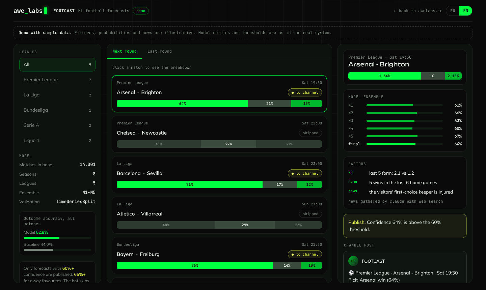
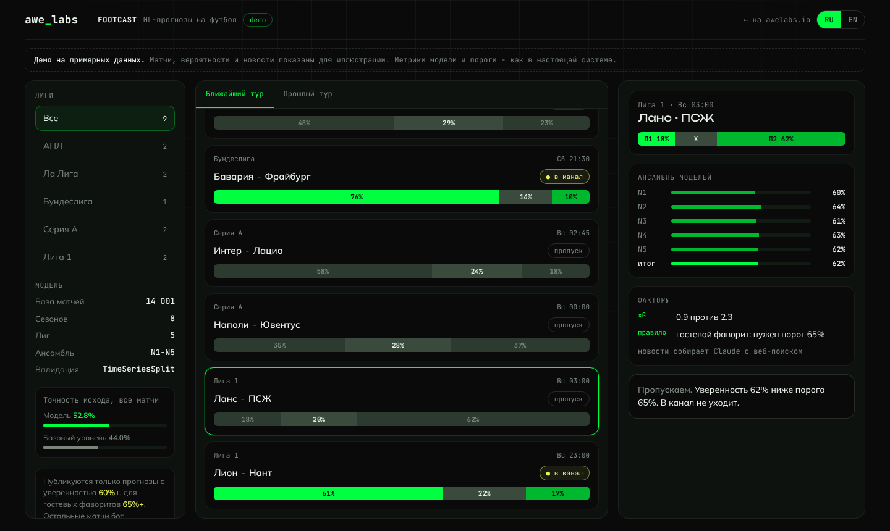

# AweLabs FOOTCAST - ML football forecasts (demo)

**Live demo:** https://awelabs.io/demo/footcast/ · **Pipeline code:** https://github.com/mikeabakumoff/awelabs-footcast

[English](#english) · [Русский](#русский)

## English

A front-end demo of FOOTCAST - an automated football forecast channel for five top leagues (Premier League, La Liga, Bundesliga, Serie A, Ligue 1).

> **Demo with sample data.** Fixtures, probabilities and news are illustrative. Model metrics and publishing thresholds match the real system.

### How the real system works
- **ML ensemble N1-N5** trained on 14,001 matches over 8 seasons, validated with TimeSeriesSplit - no look-ahead.
- **Factors:** xG form, home/away record, head-to-head; injury and suspension news gathered by Claude with web search.
- **Publishing threshold:** only forecasts with 60%+ confidence go to the channel, 65%+ for away favourites. Everything else is skipped.
- **Auto-post** to a Telegram channel: pick, confidence, expected score and the main reasons.
- **After the match** the bot checks the result itself and updates the model's accuracy.
- **Honest metric:** outcome accuracy on all matches 52.8% vs a 44.0% baseline.

### What the demo shows
| Tab | What you see |
|---|---|
| Next round | 9 fixtures: probabilities, ensemble votes, factors, publish / skip decision and the channel post |
| Last round | published picks checked against real results, hit rate, exact scores |

One static `index.html`, no build, no backend. RU / EN.

---

## Русский

Фронт-демо FOOTCAST - автоматического канала футбольных прогнозов по пяти топ-лигам (АПЛ, Ла Лига, Бундеслига, Серия А, Лига 1).

> **Демо на примерных данных.** Матчи, вероятности и новости показаны для иллюстрации. Метрики модели и пороги публикации - как в настоящей системе.

### Как работает настоящая система
- **Ансамбль ML-моделей N1-N5**, обучен на 14 001 матче за 8 сезонов, валидация TimeSeriesSplit - без заглядывания в будущее.
- **Факторы:** xG-форма, домашние и гостевые результаты, очные встречи; новости о травмах и дисквалификациях собирает Claude с веб-поиском.
- **Порог публикации:** в канал уходят только прогнозы с уверенностью 60%+, для гостевых фаворитов 65%+. Остальные матчи пропускаются.
- **Автопост** в Telegram-канал: исход, уверенность, ожидаемый счёт и главные причины.
- **После матча** бот сам проверяет результат и обновляет точность модели.
- **Честная метрика:** точность исхода на всех матчах 52.8% против базового уровня 44.0%.

### Что показывает демо
| Вкладка | Что видно |
|---|---|
| Ближайший тур | 9 матчей: вероятности, голоса моделей, факторы, решение «в канал / пропуск» и пост |
| Прошлый тур | опубликованные прогнозы против реальных результатов, процент попаданий, точный счёт |

Один статичный `index.html`, без сборки и бэкенда. RU / EN.

---

**AweLabs** - automation studio · [awelabs.io](https://awelabs.io) · [t.me/awe_labs](https://t.me/awe_labs)
